<p align="center"></p>

<h1 align="center">FridgeChef-AI</h1>

<p align="center"><b>Snap your fridge, get a dinner you will like, and cook it step by step.<br>811 recipes work offline on Android and the web; add your own AI key for more.</b></p>

<p align="center">
  <a href="https://theflighttechofficial.github.io/FridgeChef-AI/"><b>▶ Try it live</b></a> &nbsp;·&nbsp;
  <a href="https://github.com/theflighttechofficial/FridgeChef-AI/releases/latest"><b>⬇ Download the Android APK</b></a> &nbsp;·&nbsp;
  <a href="CHANGELOG.md">Changelog</a>
</p>

<p align="center">
  <a href="LICENSE"></a>
  <a href="https://github.com/theflighttechofficial/FridgeChef-AI/releases/latest"></a>
  <a href="https://github.com/theflighttechofficial/FridgeChef-AI/actions/workflows/android.yml"></a>
</p>

<table>
  <tr>
    <td align="center" width="34%">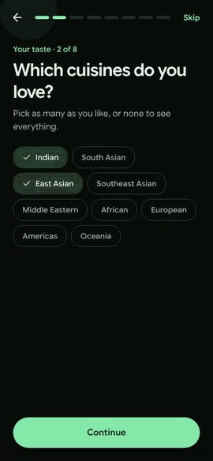</td>
    <td align="center" width="33%">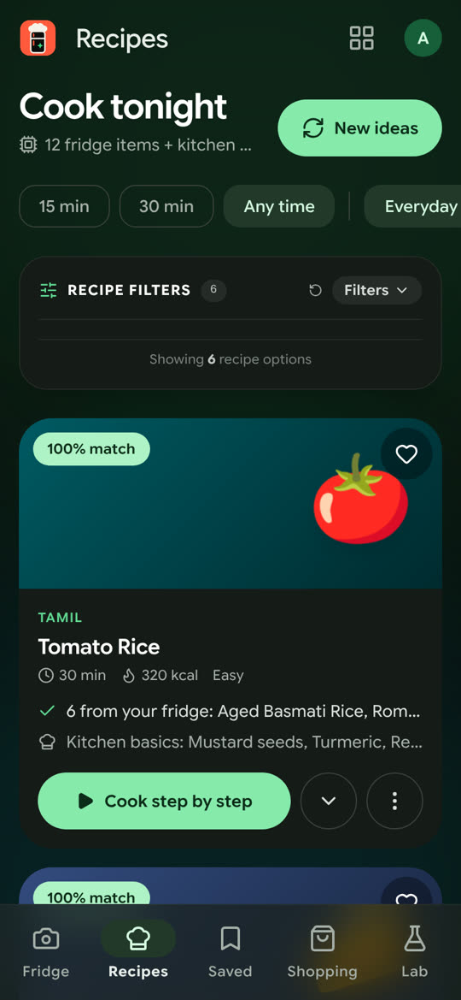</td>
    <td align="center" width="33%">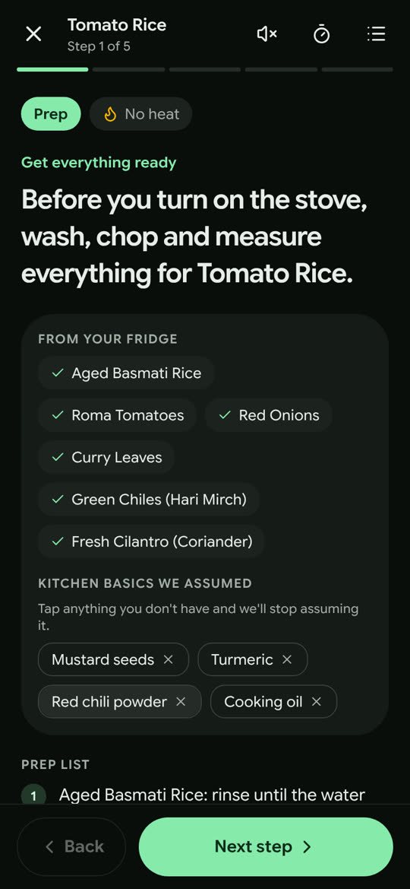</td>
  </tr>
</table>

## Quick start

1. **Open the app.** Use the [live demo](https://theflighttechofficial.github.io/FridgeChef-AI/) in any browser, or install the
   [APK](https://github.com/theflighttechofficial/FridgeChef-AI/releases/latest) on an Android phone.
2. **Answer eight taste questions** (diet, cuisines, heat, foods you love or skip), or skip them.
3. **Snap your fridge or pick a sample fridge**, then tap **Suggest recipes** and **Cook step by step**.

No account server and no API key needed: the account, your data and the recipe model live on your
device. Add a Gemini, OpenAI, Claude or other key in Settings to read fridge photos and get AI-written recipes.

**Run it yourself**

```bash
git clone https://github.com/theflighttechofficial/FridgeChef-AI.git
cd FridgeChef-AI
npm install
npm run dev          # http://localhost:3000
```

or with Docker:

```bash
docker build -t fridgechef .
docker run -p 3000:3000 fridgechef
```

## What it does

- **Recipes from what you have.** An on-device model ranks 811 recipes from 82 Indian and world
  cuisines against your ingredients in a few milliseconds, offline. Pantries it covers poorly get
  recipes composed from exactly what is there.
- **Learns your taste.** Answers to the taste questions, plus every recipe you save, cook and rate,
  change the ranking. Avoided ingredients sink to the bottom; the diet you set is always respected.
- **Assumes kitchen basics.** Salt, oil, common spices, onion, garlic and the like count as being
  at home; report any you are out of.
- **Beginner-friendly cooking mode.** Every step says how to do it, the heat level and how to tell
  when it is done, with timers and a list of what to buy.
- **Your AI, your key.** Gemini, OpenAI, Claude, Groq, OpenRouter, Mistral, DeepSeek, Grok or any
  OpenAI-compatible endpoint. Keys stay on the device. If a model is retired or over quota, the
  next one on the same key answers.
- **Account that stays with the phone.** Updates install over the old app, and a reinstall on the
  same phone signs you back in with your data (needs Android backup switched on).
- **More tools** (Lab tab and tools sheet): substitutions, meal planner, nutrition from meals you
  cooked, shopping list, receipt to pantry, food-safety checks and more. Several of these need a
  cloud AI key.

## Screenshots

<table>
  <tr>
    <td align="center" width="25%">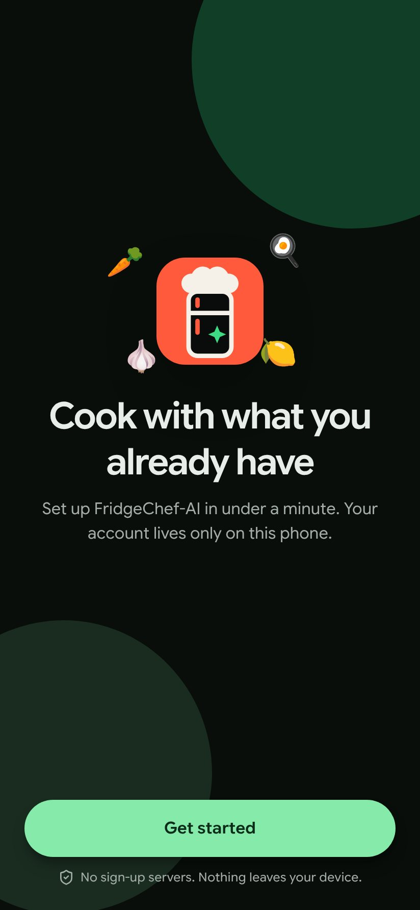<br><sub>Welcome</sub></td>
    <td align="center" width="25%">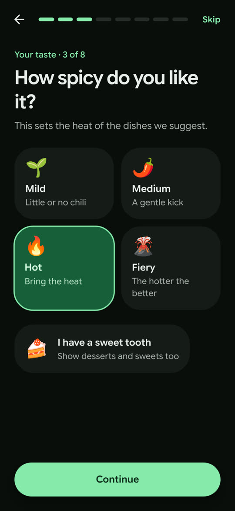<br><sub>Taste questions</sub></td>
    <td align="center" width="25%">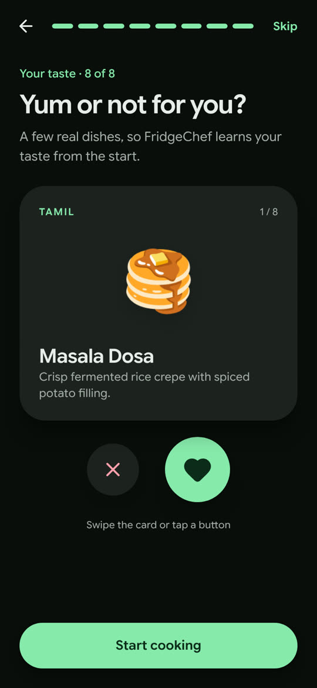<br><sub>Like or pass on dishes</sub></td>
    <td align="center" width="25%">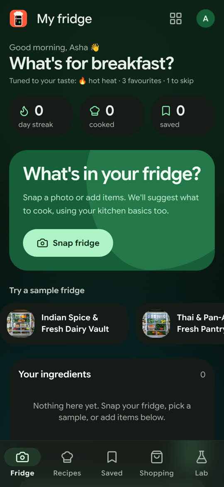<br><sub>My fridge</sub></td>
  </tr>
  <tr>
    <td align="center">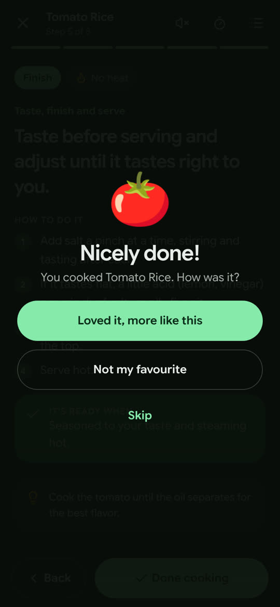<br><sub>Finished a dish</sub></td>
    <td align="center">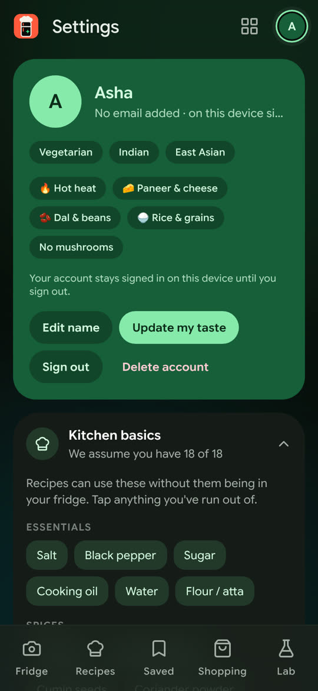<br><sub>Settings</sub></td>
    <td align="center">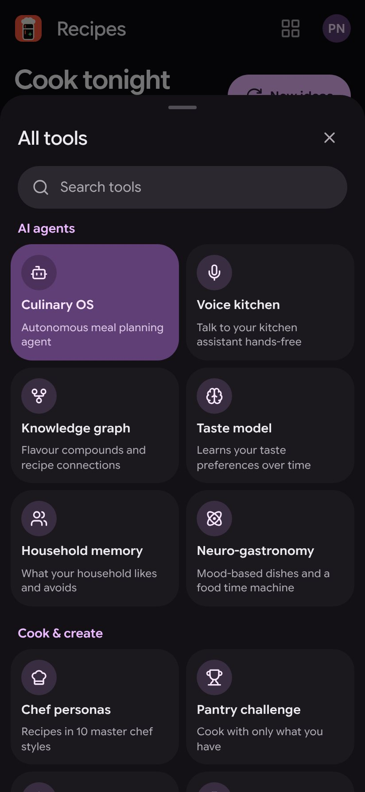<br><sub>All tools</sub></td>
    <td align="center">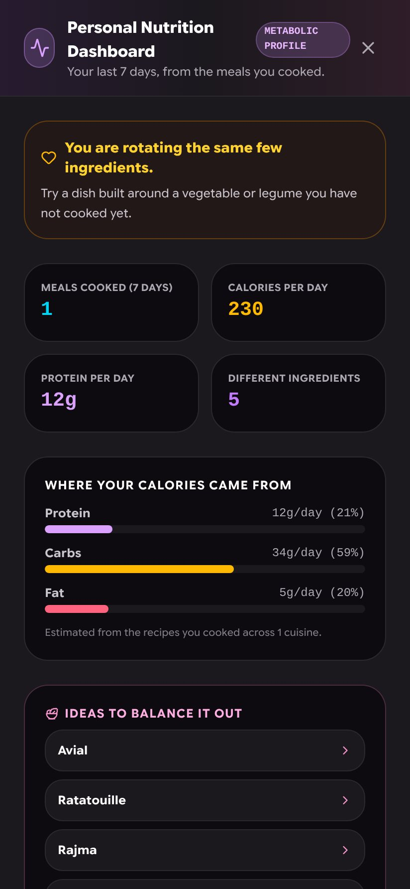<br><sub>Nutrition</sub></td>
  </tr>
</table>

<p align="center">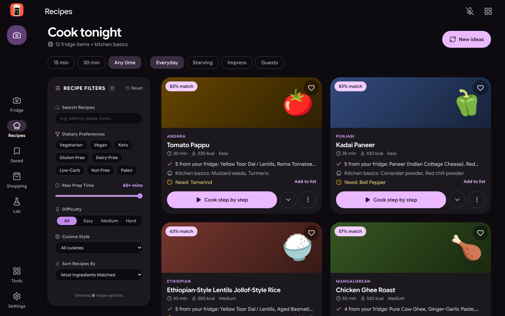<br><sub>Website on desktop</sub></p>

---

## 📑 Table of Contents

- [Quick start](#quick-start)
- [What it does](#what-it-does)
- [Screenshots](#screenshots)
- [Overview](#-overview)
- [Architecture & Tech Stack](#-architecture--tech-stack)
- [⭐ Full feature list](#-full-feature-list)
  - [1. 🧠 FridgeChef Memory Engine](#1--fridgechef-memory-engine)
  - [2. 📸 Receipt → Pantry AI](#2--receipt--pantry-ai)
  - [3. 🧊 Fridge Digital Twin](#3--fridge-digital-twin)
  - [4. 🤖 Autonomous Meal Decision Engine](#4--autonomous-meal-decision-engine)
  - [5. 🧬 Ingredient Substitution Intelligence](#5--ingredient-substitution-intelligence)
  - [6. 🧪 Recipe Evolution Engine](#6--recipe-evolution-engine)
  - [7. 👨🍳 Chef Persona Engine](#7--chef-persona-engine)
  - [8. 🎯 “Cook With What You Have” Challenge](#8--cook-with-what-you-have-challenge)
  - [9. 🧠 “Why This Recipe?” AI Explainability](#9--why-this-recipe-ai-explainability)
  - [10. 💰 Grocery Price Intelligence & Budget Mode](#10--grocery-price-intelligence--budget-mode)
  - [11. 📊 Personal Nutrition Dashboard](#11--personal-nutrition-dashboard)
  - [12. 🌍 Food Waste Carbon Calculator](#12--food-waste-carbon-calculator)
  - [13. 🌡️ Smart Fridge Sensor Integration (IoT + AI)](#13--smart-fridge-sensor-integration-iot--ai)
  - [14. ⚖️ Food Safety Intelligence](#14--food-safety-intelligence)
  - [15. 🧑🤝🧑 Multi-Person Household Profiles](#15--multi-person-household-profiles)
  - [16. 🗣️ Natural Conversational Kitchen Agent](#16--natural-conversational-kitchen-agent)
  - [17. 🧠 Recipe Knowledge Graph](#17--recipe-knowledge-graph)
  - [18. 🔬 AI Recipe Scientific Validation](#18--ai-recipe-scientific-validation)
  - [19. 🧑🍳 Cooking Skill Adaptation](#19--cooking-skill-adaptation)
  - [20. 📷 Plate Photo → Food & Plating Analysis](#20--plate-photo--food--plating-analysis)
  - [21. 🧠 Taste Preference Learning Model](#21--taste-preference-learning-model)
  - [22. 🕐 Context-Aware Cooking & Moods](#22--context-aware-cooking--moods)
  - [23. 🎉 Event & Guest Mode (AI Catering Planner)](#23--event--guest-mode-ai-catering-planner)
  - [24. 🧾 Pantry Financial Intelligence](#24--pantry-financial-intelligence)
  - [25. 🤖 Autonomous Culinary Operating System Agent](#25--autonomous-culinary-operating-system-agent)
- [Complete Feature & Component Inventory](#-complete-feature--component-inventory)
  - [1. AI Vision & Fridge Scanner](#1-ai-vision--fridge-scanner)
  - [2. Native Android & Material 3 Experience](#2-native-android--material-3-experience)
  - [3. Recipe Engine & Filtering](#3-recipe-engine--filtering)
  - [4. Hands-Free Voice Cooking & Step-by-Step Guidance](#4-hands-free-voice-cooking--step-by-step-guidance)
  - [5. Pantry Health & Expiration Management](#5-pantry-health--expiration-management)
  - [6. 7-Day Meal Planner & Sommelier Pairings](#6-7-day-meal-planner--sommelier-pairings)
  - [7. Advanced Culinary & Sensory Science Labs](#7-advanced-culinary--sensory-science-labs)
  - [8. Smart Shopping List & Household Sync](#8-smart-shopping-list--household-sync)
- [Project Directory Structure](#-project-directory-structure)
- [Backend API Endpoints](#-backend-api-endpoints)
- [Getting Started & Local Development](#-getting-started--local-development)
- [Environment Variables](#-environment-variables)
- [Build, Verification & Deployment](#-build-verification--deployment)
- [License](#-license)

---

## 📱 Android app, website and Material 3 design

FridgeChef ships as **one codebase, two targets**:

- **Website**: `npm run dev` (development) or `npm run build && npm start` (production).
- **Android app**: a [Capacitor](https://capacitorjs.com) project in `android/` wraps the same build.
  - `npm run android:sync` builds the web app and copies it into the Android project.
  - `npm run android:open` opens it in Android Studio; `npm run android:run` installs on a connected device.
  - CI: `.github/workflows/android.yml` builds a debug APK on every push and attaches it to `v*` releases.
    Set the repository variable `FRIDGECHEF_API_BASE_URL` to bake in your server URL.

The interface follows **Material 3 (Material You)**: top app bar, bottom navigation bar on phones,
navigation rail on tablets and desktop, an extended "Snap fridge" FAB, a searchable tools sheet,
large rounded shapes and Google Sans Flex. Every colour comes from tonal palettes derived from one
seed hue (`src/index.css`, `src/theme/dynamicColor.ts`), so Settings → Colours re-tints the whole app.

### Account that stays with the phone

The account lives only on the device. Signing in once keeps the person signed in.

- **Updates keep everything.** Every debug APK is signed with the same key
  (`android/app/fridgechef-debug.keystore`) and carries a rising version code, so a new build
  installs over the old one without removing the account or its data. If the installed app came
  from a build made before this key existed, remove it once; later updates install in place.
- **Reinstall on the same phone signs back in.** The Android app keeps a copy of the account and
  its data (pantry, saved recipes, shopping list, taste answers, history, AI key) in the app's
  preferences (`src/native/deviceVault.ts`), which Android includes in its backup. On a fresh
  install the copy is put back before the app starts; when the phone's ID matches, the person is
  signed in at once. On a different phone the data comes back but the password is asked for.
  This needs Android backup switched on for the phone (Settings → Google → Backup), and Android
  makes backups about once a day, so data from the last few hours before an uninstall may be
  missing. The fridge photo is not part of the copy; the ingredient list is.
- **Website:** data stays in the browser's storage for that site, and the app asks the browser
  to keep it when storage runs low.
- The debug signing key is public. Use a private key for a Play Store release.

### Taste questions

After the account is created the app asks eight short questions: diet, favourite cuisines, how
spicy, foods the person loves, foods to skip, cooking skill and time, goals, and a stack of real
dishes to like or pass. The answers (`src/state/tasteProfile.ts`) change how every recipe is
scored on the device, are sent to cloud AI as one sentence, and can be changed any time in
Settings → Update my taste.

## 🔑 Bring your own AI key

Settings → **Your AI provider** accepts a key for Google Gemini, OpenAI, Anthropic Claude, Groq,
OpenRouter, Mistral, DeepSeek, xAI Grok, or any OpenAI-compatible endpoint (Ollama, LM Studio).
Pick a model, then press **Test connection**.

- The key is stored only on the device (localStorage).
- On the website, `/api` requests carry it in `x-fc-provider` / `x-fc-key` / `x-fc-model` headers.
  The server (`server/llm.ts`) uses it for that request only and never stores, caches or logs it.
- Custom endpoints are called directly from the device; the server never fetches user-supplied URLs.
- In the Android app without a server, recipe ideas and photo reading call the provider directly.

## 🧠 On-device recipe model

`src/ml/` holds a recipe recommender that runs fully offline:

- **Kitchen basics** (`src/ml/basics.ts`): salt, oil, common spices, onion, garlic, ginger, green chili,
  coriander leaves and lemon are assumed to be at home, so recipes can use them without them being in the
  fridge scan. Tap one under *Kitchen basics* (Fridge tab or Settings), or on the cooking screen's prep step,
  to report you're out of it; from then on it counts as missing. Cloud AI is told the same list.
- **Detailed method** (`src/ml/elaborate.ts`): every recipe opens with a prep step (what to wash, chop and
  measure), each cooking step adds how to do it, the heat to use and how to tell it's done, and a final step
  covers tasting, garnish and serving.

- **Recipes**: 811 recipes across 82 cuisines in 10 regions (`src/ml/data/`):
  - **Indian, 25 regional cuisines**: Punjabi, North Indian, Mughlai, Awadhi, Kashmiri, Rajasthani, Gujarati,
    Maharashtrian, Goan, Mangalorean, Sindhi, Parsi, Bengali, Odia, Bihari, Northeast Indian, Hyderabadi, Andhra,
    Tamil, Chettinad, Kerala, Karnataka, Indo-Chinese, street food and sweets (`indian.ts`, `more-indian.ts`).
  - **World**: South Asian (Pakistani, Sri Lankan, Nepali, Tibetan, Afghan), East Asian, Southeast Asian,
    Middle Eastern, African, European, the Americas and Oceania (`world.ts`, `more-asia.ts`, `more-world.ts`, `recipes.ts`).
  - **Everyday home cooking**: breakfasts, quick lunches, simple dinners, snacks, sweets and drinks (`everyday.ts`).
- **Ingredients**: 217 canonical ingredients with Hindi, regional and international aliases (`ingredients.ts`).
  Free-text pantry names such as "Lean Ground Beef (90/10)" or "Green Chillies" are mapped onto them by
  `src/ml/normalize.ts`.
- **Training** (`npm run train:model`, deterministic, about 20 seconds):
  1. Ingredient embeddings: PPMI co-occurrence factorised to 24 dimensions, retrofitted to culinary groups, so
     substitutes sit close (spinach ~ mustard greens ~ kale, paneer ~ feta).
  2. Cuisine classifier: multinomial naive Bayes over ingredients. Leave-one-out accuracy is 72% for region and
     48% top-3 across all 82 fine-grained cuisines.
  3. Ranker: listwise softmax over 8 features, including the classifier's region fit. It is trained on 16,960
     simulated pantries, each with 8 near-miss decoys and 16 random ones.
- **Held-out results** (4,240 pantries, 25 candidates each): top-1 57%, top-3 78%, MRR 0.70, against 38% / 63% /
  0.55 for plain ingredient matching.
- **Any ingredients**: `src/ml/composer.ts` builds a recipe from exactly what is in the fridge when the corpus covers
  it poorly. The classifier picks the cuisine, or you pick one in the filters. The pantry decides the technique:
  curry, stir-fry, noodles, rice, eggs or vegetables. Dietary filters drop items that do not fit.
- **Personal taste**: `src/ml/tasteModel.ts` is an online logistic regression that learns from saves and cooks on
  the device. You can reset it in Settings.
- **Cuisine filter**: grouped by region. Pick a whole region ("All Indian") or a single cuisine ("Chettinad").
- Tests: `npm test`.

## 🌟 Overview

FridgeChef turns what is already in your fridge into a meal. It reads a fridge photo with a cloud
vision model (your own key) or takes a typed list, ranks recipes with an on-device model, and walks
you through cooking with timers and spoken steps. One React codebase runs as a website and, through
Capacitor, as an Android app with Material 3 design, haptics and spring animations.

The long feature list below describes every screen in the app. Features marked as needing AI use
your own key; without one they show offline sample results.

---

## 🛠️ Architecture & Tech Stack

| Layer | Technologies | Purpose |
|---|---|---|
| **Frontend Framework** | React 19 + TypeScript | High-performance, concurrent rendering with strict typing |
| **Build Tool & Bundler** | Vite 8 + `@vitejs/plugin-react` | Instant HMR and optimized production bundles |
| **Styling & Design System** | Tailwind CSS v4 (`@tailwindcss/vite`) | Token engine with glassmorphic dark mode styling |
| **Animations & Motion** | Framer Motion 13 | Physics-based spring animations, tab morphing, and heart bursts |
| **Server & Middleware** | Express 4 + TSX | Unified full-stack server running Vite middlewares in dev mode |
| **Artificial Intelligence** | `@google/genai` (Gemini API with Groq & Offline Fallbacks) | Vision-based fridge audits, dynamic recipe synthesis, OCR, and audio TTS |
| **Sound & Haptics** | Web Audio API + Web Speech API + Web Vibration API | Synthesizer kitchen chimes, speech synthesis, and mobile tactile pulses |
| **Data Visualizations** | Recharts + D3 / SVG Radar Charts | Multi-axis nutritional radar charts and carbon waste trend graphs |

---

## ⭐ Full feature list

### 1. 🧠 FridgeChef Memory Engine
- **Persistent Personal Culinary Model**: Maintains a persistent memory profile for the entire household rather than operating as a stateless bot.
- **Multi-Member Preferences**: Tracks profiles for family members (*e.g., Chef, Priya, Arjun*), detailing:
  - Disliked ingredients per member (*e.g., "Arjun dislikes mushrooms; exclude raw cilantro for Priya"*)
  - Spice tolerances on a 1–5 scale (*Mild, Gentle, Medium, Hot, Explosive*)
  - Medical allergens and intolerances (*Peanuts, lactose sensitivities*)
  - Preferred appliances (*Air Fryer, Induction Wok, Instant Pot, Claypot*)
  - Household budget tier (*Value, Balanced, Gourmet*) and cooking skill level
- **Contextual Proactive Observations**: Emits real-time conversational culinary advice such as:
  > *"You usually prefer spicy South Indian breakfasts and you haven't used the spinach you bought 4 days ago."*

### 2. 📸 Receipt → Pantry AI
- **Automated Grocery Bill Extraction**: Snap or upload any supermarket paper receipt (or select instant presets from DMart, Whole Foods, Reliance Fresh).
- **Gemini OCR Parsing**: Automatically parses line items, unit quantities (*500 g, 1 L, 12 pcs, 5 kg*), estimated gram weights, and unit pricing.
- **Pantry Health Metrics**:
  - Calculates total spend (*₹1,842 / $48.50*), total food mass (*6.2 kg*), and **Pantry Utilization Index (91%)**.
  - Automatically predicts storage locations and sets expiration alarms (*Chicken: 3 days, Spinach: 4 days, Milk: 6 days, Rice: 365 days*).
- **1-Click Sync & Cook**: Transports parsed groceries directly into the live fridge inventory and generates instant zero-waste meal suggestions.

### 3. 🧊 Fridge Digital Twin
- **Interactive 2.5D Refrigerator Representation**: A physical digital twin model of your home refrigerator with LED ceiling lighting, glass dividers, and live telemetry (*Fridge: 37.2°F, Freezer: -0.4°F*).
- **Microclimate Zones**:
  - **Top Shelf (38°F)**: Dairy, eggs, cheeses, and baked goods.
  - **Middle Shelf (36°F)**: Cooked proteins, tofu, and prepared meals.
  - **Crisper Drawer (85% RH)**: Fresh produce, tomatoes, bell peppers, and humidity-sensitive greens.
  - **Deep Freezer (-18°C / 0°F)**: Sub-zero frozen proteins, edamame, and frozen vegetables.
- **Telemetry Inspection Drawer**: Click any item on any shelf to inspect its quantity, color-coded freshness score, days until expiration, and 1-click **"Find Recipes with This"** shortcut.

### 4. 🤖 Autonomous Meal Decision Engine
- **"What Should I Cook Right Now?"**: Eliminates choice fatigue. Instead of asking the user to browse hundreds of recipes, an autonomous decision engine selects the single optimal dinner to prepare.
- **Multi-Variable Weighted Algorithm**:
  1. **Expiring Ingredients Urgency (35%)**: Prioritizes ingredients nearing expiration to prevent waste.
  2. **Household Memory & Spice Calibration (25%)**: Satisfies personal taste while strictly excluding member dislikes.
  3. **Time Budget (15%)**: Calibrated to evening energy levels and current meal hours.
  4. **Nutritional Targets (15%)**: Ensures high protein (30g+) and balanced macros.
  5. **Kitchen Weather & Temperature Comfort (10%)**: Warms with aromatics during cool evenings (21°C) or refreshes during heatwaves.
- **Definitive Output**: Generates an authoritative meal recommendation card (*Spiced Chicken & Wilted Spinach Rice Skillet | 24 min | ₹68 est. cost | 31g protein | 180g waste prevented*) with an instant 1-click launch into Hands-Free Voice Cooking mode.

### 5. 🧬 Ingredient Substitution Intelligence
- **Culinary Chemistry Graph**: Dynamically queries molecular culinary pairings when ingredients are missing.
- **Comprehensive Substitution Matrix**:
  - Analyzes target ingredient role (*Aged umami depth, crystalline texture, salinity & fat binding*).
  - Evaluates alternative substitutes (*Nutritional Yeast, Grana Padano, Aged Cheddar, Cashew + Nutritional Yeast*).
  - Displays **Flavor Similarity %** (*e.g., 87%*) and **Texture Similarity %** (*e.g., 74%*).
  - Checks live fridge inventory and flags **"IN YOUR FRIDGE ✅"** when an alternative is already owned.
  - Provides exact conversion ratios and chef technique adjustments (*e.g., "1:1 ratio, but reduce added salt by 15%"*).

### 6. 🧪 Recipe Evolution Engine
- **“Make this recipe better”**: Mutation engine allowing users to evolve any recipe into 6 specialized evolutionary branches:
  - **Higher Protein**: Re-engineers the dish to deliver 40–50g+ lean protein by swapping white grains for edamame/lentils and folding in whipped Greek yogurt garlic crema.
  - **Lower Calorie**: Volume eating re-engineering (-35% kcal) utilizing riced cauliflower, shredded charred cabbage, and air-fry searing.
  - **More Spicy**: Multi-dimensional heat bloomed in hot oil with Sichuan peppercorns, bird’s eye chiles, and scallion chili crisp.
  - **Restaurant Style**: Michelin elevation featuring French *arroser* butter-basting, shallot pan fond deglazing, and golden ratio layering.
  - **Budget Version**: Cuts cost by 58% utilizing brown lentils, chickpeas, and hearty root staples without sacrificing rich savory umami.
  - **15-Minute Flash**: One-skillet high-heat technique using paper-thin sliced ingredients and pre-mixed 30-second slurries.
- **Side-by-Side Comparison**: Live diff inspection showing macro shifts, modification lists, secret ingredients, and chef notes with 1-click **"Cook This Version"** launch.

### 7. 👨🍳 Chef Persona Engine
- **10 Iconic Culinary Master Styles**: Morph ingredients according to master chef styles:
  - 🇮🇳 **Indian Master Chef**: Aromatic tadka blooming, mustard seeds, curry leaves, and layered claypot braises.
  - 🇯🇵 **Japanese Washoku Shokunin**: Subtle dashi broths, mirin-soy umami precision, and delicate sashimi-grade cuts.
  - 🇮🇹 **Italian Nonna & Trattoria**: Blistered high-heat San Marzano tomatoes, silky olive oil emulsions, and al dente discipline.
  - 🇫🇷 **French Haute Cuisine**: Foaming butter basting (*arroser*), velouté reductions, and classical brigade refinement.
  - 🇰🇷 **Korean Hansik Master**: Aged kimchi fermentation, gochujang heat, toasted sesame oil, and sizzling scorched pans.
  - 🇲🇽 **Mexican Abuela & Taqueria**: Charred fire-roasted chiles on the comal, fresh lime acid punch, and toasted cumin.
  - 🧪 **Modernist Gastronomist**: Molecular agar spherification pearls, savory light espumas, and precision thermal cooking.
  - 💪 **Macro & Performance Coach**: Maximum lean protein per calorie, clean carb timing, and zero industrial seed oils.
  - 💰 **Frugal Pantry Wizard**: Root-to-stem zero-waste usage, grain stretching, and fond-enriched pan gravies.
  - 🏠 **Homestyle Comfort Kitchen**: Nostalgic warming one-pot stews with zero fuss and quick single-pan cleanup.

### 8. 🎯 “Cook With What You Have” Challenge
- **Gamified Pantry Arena**: Converts random fridge remnants into a scored culinary competition.
- **Select or Mystery Roll**: Pick 3–5 items from your fridge or roll the randomized dice.
- **5-Dimensional AI Jury Score**:
  - **Ingredient Utilization** (*e.g., 94%*)
  - **Creativity Score** (*e.g., 87%*)
  - **Nutrition Score** (*e.g., 82%*)
  - **Waste Reduction** (*e.g., 96%*)
  - **Difficulty Score** (*e.g., 61%*)
- **Progression & Streaks**: Earns XP (+380 XP), tracks consecutive cooking streaks (*5-Day Streak 🔥*), and unlocks badges (*"Zero-Waste Prodigy"*, *"Scrappy Gourmet"*, *"Pantry Alchemist"*).

### 9. 🧠 “Why This Recipe?” AI Explainability
- **Zero Black Box Transparency**: Algorithmic point-by-point explainability:
  - `+31` Chicken and fresh baby spinach expire in 48 hours (Urgency)
  - `+24` Delivers 42g protein, matching your lean protein target
  - `+18` 100% in-stock utilization of existing pantry items
  - `+15` Aligns with your household South Indian / Mediterranean preference
  - `+8` Low energy footprint (one-skillet induction hob, 0.35 kWh)
  - `−5` Requires 1 minor staple that can be easily substituted
  - **Final Explainability Score**: `91/100` Selection Confidence.

### 10. 💰 Grocery Price Intelligence & Budget Mode
- **Macro-Cost Arbitrage**: Connects every recipe to ingredient pricing and macronutrient value.
- **Key Financial Metrics**:
  - Estimated recipe cost (*e.g., ₹142 / $3.60*)
  - Total protein (*e.g., 42 g*) and caloric density (*618 kcal*)
  - **Cost per 10g Protein** (*e.g., ₹33.8 / 10g protein / $0.85*)
- **“Feed 4 People Under Target Budget” Budget Mode**:
  - Set party size and budget target.
  - AI engineers a meal plan strictly under the budget limit, with an itemized grocery breakdown showing *Pantry (Free)* vs *To Buy* items, with 1-click export to the shopping list.

### 11. 📊 Personal Nutrition Dashboard
- **Metabolic Profile Tracking**:
  - Calories, Protein, Carbohydrates, Fat, Dietary Fiber, Sodium, Sugar, and Micronutrients (Iron, Potassium, Vitamin C, Calcium).
  - 7-day rolling history and Meal Diversity Score (*19 unique plant & protein sources this week*).
- **Proactive AI Diagnosis**:
  > *"Your week is protein-heavy but fiber-light (14g avg vs 30g daily baseline)."*
- **Corrective Meal Suggestions**: Recommends balancing recipes (*e.g., Spiced Green Lentil & Sautéed Kale Bowl [+16g Fiber]*) with 1-click recipe filtering.

### 12. 🌍 Food Waste Carbon Calculator
- **Planetary Ecological Impact**:
  - **Food Rescued**: `3.8 kg` this month
  - **Estimated Money Saved**: `₹1,240` ($16.20) in groceries
  - **Landfill Waste Avoided**: `4.6 kg`
  - **CO₂ Methane Avoided**: `8.2 kg`
  - **Virtual Water Saved**: `2,900 L` of embedded agricultural water
- **🌱 Household Sustainability Score (84/100)**: Transparent breakdown across Waste Diversion (91%), Resource Efficiency (88%), Local Seasonality (85%), and Packaging Avoidance (72%).

### 13. 🌡️ Smart Fridge Sensor Integration (IoT + AI)
- **Connected Hardware Sensor Hub**:
  - Temperature (*3.8°C / 38.8°F* with normal range boundary checks)
  - Humidity (*84% RH* crisper climate)
  - Door status sensor (*Closed vs Ajar*, open duration tracking)
  - Shelf load cell weight sensors (*Milk bottle: 320g remaining of 1L*)
  - Gas/VOC odor sensors (*12 ppm pure air*) & Ethylene gas ripening levels
- **Interactive Anomaly Engine**:
  > *"⚠️ Temperature anomaly: Fridge temperature increased from 3.8°C → 8.1°C for 27 minutes. Refrigerator door left unlatched."*
  - One-tap diagnostics from the tools sheet.

### 14. ⚖️ Food Safety Intelligence
- **Deterministic HACCP & Hygiene Engine**:
  - Per-ingredient safe handling window (*Safe / Cook Today / Caution / Discard*) with opened-date tracking.
  - Safe internal cooking target temperatures (*Poultry: 74°C / 165°F, Ground meats: 71°C / 160°F, Fish: 63°C / 145°F*).
  - Cross-contamination warnings (*e.g., Raw poultry juices harbor Salmonella; store only on lowest shelf below ready-to-eat greens*).
  - Physical raw/cooked separation rules and medical allergen cross-contact notices.

### 15. 🧑🤝🧑 Multi-Person Household Profiles
- **Multi-Member Dietary Conflict Resolution**:
  - Tracks individual family member profiles (*e.g., Varun: High Protein + Spicy + No Mushrooms; Mom: Vegetarian + Mild; Dad: Low Sodium; Arjun: Kid-friendly*).
- **“Dinner for Everyone” Synthesizer**:
  - Harmony Score (*94/100*).
  - Chooses ONE single harmonious base recipe (*Fragrant Turmeric Rice & Roasted Mediterranean Veg Base*).
  - Generates modular parallel modifications for each member (*e.g., sear chili chicken skewers for Varun, fold golden paneer for Mom, separate unsalted lemon-herb portion for Dad*) without cooking separate meals.

### 16. 🗣️ Natural Conversational Kitchen Agent
- **Two-Way Voice Culinary Dialogue**:
  - Voice dialog interaction loop:
    - User: *"Hey FridgeChef, what can I make?"*
    - AI: *"You’ve got chicken, baby spinach, and rice. I can make a 22-minute high-protein garlic chicken bowl."*
    - User: *"Make it spicier."*
    - AI: *"Done! Increasing crushed bird’s eye chili, garlic, and cracked pepper while keeping sodium stable."*
    - User: *"Start cooking."*
    - AI: *"Starting your step-by-step hands-free cooking session now!"*
  - Integrated speech recognition (`webkitSpeechRecognition`), browser TTS voice synthesis, live recipe draft updates, and handoff into full-screen hands-free cooking.

### 17. 🧠 Recipe Knowledge Graph
- **Interactive Culinary Chemistry Ontology**:
  - Maps structured relationships: `Ingredient` → `Flavor Compounds` → `Cooking Techniques` → `Cuisines` → `Recipes` → `Substitutions`.
  - Example: *Tomato* ├── acidity ├── glutamate ├── umami ├── roasting ├── Mediterranean └── Tamarind/Sumac substitutes.
  - Interactive visual node graph allows cooks to explore molecular flavor affinity before cooking.

### 18. 🔬 AI Recipe Scientific Validation
- **Tri-Tier Automated Recipe Auditor**:
  - **Culinary Validator**: Flavor compound compatibility (96%), cooking temperature bounds (190°C skillet), timing feasibility (94%), texture score (92%).
  - **Nutrition Validator**: Caloric variance (<3%), macro alignment, portion scale precision.
  - **Safety Validator**: HACCP raw poultry/seafood thermal threshold (74°C), cross-contamination prevention, holding temp safety.
- **Recipe Confidence Score (94%)**: Displays an official sensory integrity badge on every recipe card with audit logs.

### 19. 🧑🍳 Cooking Skill Adaptation
- **Dynamic Skill Adaptation**: Selector for 🟢 **Beginner**, 🟡 **Intermediate**, and 🔴 **Advanced**.
- **Instruction Morphing**:
  - *Beginner*: “Heat the pan on medium for about 60 seconds until warm when hovering your hand 2 inches above.”
  - *Intermediate*: “Heat the skillet until oil shimmers and coats the pan in a thin veil.”
  - *Advanced*: “Preheat heavy cast iron until lightly smoking (wisps at 425°F); sear in clarified fat to develop a deeply caramelized Maillard crust.”

### 20. 📷 Plate Photo → Food & Plating Analysis
- **Post-Cooking Vision Evaluation**: Snap or upload a photo of your finished plate.
- **AI Plate Scorecard**:
  - 🍽️ Presentation: `82 / 100`
  - 🥦 Nutritional Balance: `91 / 100`
  - 🌈 Color Diversity: `88 / 100`
  - 📐 Plating Geometry: `79 / 100`
- **Actionable Master Chef Feedback**:
  > *"Add a small acidic garnish (pickled shallots or micro-cilantro) and move the protein slightly off-center using the rule-of-thirds."*

### 21. 🧠 Taste Preference Learning Model
- **Reinforcement Learning Feedback**: Rate meals (1-5 stars) + interactive taste tags (*"Loved the garlic"*, *"Too salty"*, *"Perfect crisp"*).
- **Personal Taste Vector**:
  - *Favored Flavors*: Roasted Garlic (98%), Peppercorn Heat (94%), Citrus Brightness (91%).
  - *Favored Textures*: Crispy Seared Fond (96%), Al Dente Crunch (89%).
  - *Penalized Elements*: Raw Cilantro Stems (-88%), Cloying Sweet Glazes (-84%).

### 22. 🕐 Context-Aware Cooking & Moods
- **Time Budgets**: `5 min` (Flash microwave) | `15 min` (Wok blast) | `30 min` (Standard) | `60+ min` (Slow braise).
- **Contextual Mood Modes**:
  - 🏃 *"I'm Starving"* → Fast meal mode (zero prep, high velocity).
  - 🍷 *"I Want to Cook Something Impressive"* → Gourmet mode (Michelin techniques).
  - 🥂 *"I Have Guests Coming"* → Hosting mode (low active attention during party).

### 23. 🎉 Event & Guest Mode (AI Catering Planner)
- **Hospitality Logistics Engine**:
  - Inputs: Guests (8), Budget (₹2,500), Cuisine (Indian Royal), Dietary Split (3 Veg, 5 Non-Veg), Prep Time (2 Hours).
  - Outputs: Multi-course scaled menu, itemized procurement shopping checklist, T-minus prep timeline, and serving schedule.

### 24. 🧾 Pantry Financial Intelligence
- **Grocery Budget Breakdown**:
  - Monthly spending distribution: Protein (37%), Produce (25%), Dairy (15%), Snacks (13%), Grains (10%).
- **Spoilage Loss Audit**:
  > *"⚠️ ₹620/month lost to expired produce and unused dairy."*
- Identifies repeat offender items (*e.g., Fresh Cilantro wasted 3x*) and provides zero-waste preservation techniques.

### 25. 🤖 Autonomous Culinary Operating System Agent
- **Capstone Autonomous Feature**:
  - High-level prompt: *"Plan my meals for this week while minimizing food waste and keeping groceries below ₹2,500."*
- **12-Stage Autonomous Loop**:
  1. Pantry Audit → 2. Expiry Inspection → 3. Taste Preference Analysis → 4. 7-Day Cyclical Meal Planning → 5. Ingredient Cross-Reuse Optimization → 6. Nutritional Equilibrium Verification → 7. Cost Arbitrage Enforcement → 8. Consolidated Shopping List Generation → 9. Cooking Order Scheduling → 10. Voice Guidance Mapping → 11. Leftover Repurposing → 12. Continuous Feedback Learning.
- **Results**: `92%` Pantry Utilization, `₹1,180` Projected Savings, `4.8 kg` Waste Reduction, `₹2,140` Total Weekly Spend.

---

## 🚀 Complete Feature & Component Inventory

### 1. AI Vision & Fridge Scanner
- **Multi-Modal Image Analysis**: Upload or capture an image of any refrigerator or pantry. Google Gemini inspects visible items, predicts ingredient categories, measures confidence scores, and determines freshness stages.
- **Structured Shelf Inventory**: Categorizes items into *Produce, Dairy & Eggs, Meat & Seafood, Pantry, Condiments, Fermented, Bakery, Grains & Pulses*.
- **Interactive Stash Editor**: Add items manually, modify quantities, update freshness levels, or delete consumed goods.
- **Curated Preset Fridges**: Test preset inventories (*Fresh Harvest & Dairy Stash, High-Protein & Green Power, Asian Umami & Fermented Pantry*).

### 2. Native Android & Material 3 Experience
- **Material 3 shell ([AppShell.tsx](src/components/shell/AppShell.tsx))**: top app bar, bottom navigation bar with pill indicator, navigation rail on wide screens, extended "Snap fridge" FAB that shrinks on scroll, and a draggable tools sheet.
- **Android back button** closes the tools sheet, then returns to the Fridge tab, then leaves the app.
- **Tactile Haptic Feedback**: `navigator.vibrate()` integrated into button clicks, tab navigation, recipe favoriting, and voice command triggers.

### 3. Recipe Engine & Filtering
- **Zero-Waste Match Algorithm**: Displays matching percentages (*e.g., 92% Match*) and highlights matched vs missing ingredients.
- **Advanced Multi-Facet Filtering ([SidebarFilter.tsx](src/components/SidebarFilter.tsx))**: Filter by meal type, prep time duration, difficulty level, cuisine style, and cooking appliance (*Air Fryer, Sous Vide, Instant Pot, Claypot, Wok, Oven*).
- **Hexagonal Nutritional Radar Chart ([D3RadarChart.tsx](src/components/D3RadarChart.tsx))**: Visualizes macronutrient and micronutrient balance across 6 axes: *Protein, Fats, Carbs, Fiber, Vitamins, and Minerals*.
- **Sub-Recipe Breakdown ([SubRecipeModal.tsx](src/components/SubRecipeModal.tsx))**: Separates recipes into independently timed sub-components.
- **Batch Cooking & Tupperware Scaler ([MealPrepBatchModal.tsx](src/components/MealPrepBatchModal.tsx))**: Re-calculates portions (1x, 2x, 4x, 8x), container requirements, and freezer burn shelf-life limits.

### 4. Hands-Free Voice Cooking & Step-by-Step Guidance
- **Full-Screen Interactive Cooking Modal ([StepByStepCookingModal.tsx](src/components/StepByStepCookingModal.tsx))**: Designed for kitchen hands with large touch targets and high-contrast typography.
- **Voice Read-Aloud (TTS)**: Web Speech API & Gemini TTS voice engine.
- **Siri-Style Voice Waveform Pulse ([VoiceInteractionHapticPulse.tsx](src/components/VoiceInteractionHapticPulse.tsx))**: Animated waveform bars and pulsing ambient rings indicate active voice narration.
- **Multi-Timer Command Center**: Run step-specific timers alongside persistent kitchen multi-timers.

### 5. Pantry Health & Expiration Management
- **Pantry Health Notification System ([PantryHealthNotificationBanner.tsx](src/components/PantryHealthNotificationBanner.tsx))**: Scans fridge database for items expiring within 48-72 hours with Web Notification API push alerts.
- **Spoilage Simulator ([ExpirationSimulatorWidget.tsx](src/components/ExpirationSimulatorWidget.tsx))**: 1-to-30 day decay timeline slider.
- **Pantry Emergency Mode ([PantryEmergencyMode.tsx](src/components/PantryEmergencyMode.tsx))**: 1-click rescue mode prioritizing zero-waste recipes using expiring ingredients.
- **Smart Tupperware Tracker ([TupperwareTrackerWidget.tsx](src/components/TupperwareTrackerWidget.tsx))**: Logs leftover container locations, freeze dates, and defrost recommendations.
- **Household Chore Leaderboard ([HouseholdChoreLeaderboardWidget.tsx](src/components/HouseholdChoreLeaderboardWidget.tsx))**: Gamified points system awarding household members +25 pts for completing fridge audits.

### 6. 7-Day Meal Planner & Sommelier Pairings
- **Zero-Waste 7-Day AI Meal Planner ([WeeklyMealPlannerWidget.tsx](src/components/WeeklyMealPlannerWidget.tsx))**: Full Monday–Sunday schedule with 1-click shopping export.
- **Gourmet Beverage & Sommelier Pairing ([GourmetSommelierWidget.tsx](src/components/GourmetSommelierWidget.tsx))**: Sommelier-curated fine wines, craft beers, and zero-proof mocktails.

### 7. Advanced Culinary & Sensory Science Labs
- **Molecular & Physics Lab ([MolecularLabTab.tsx](src/components/MolecularLabTab.tsx))**: Emulsion stability indexes, Maillard reaction browning temperature predictors, and acidity/pH pairing.
- **Acoustic Sensory Lab ([AcousticSensoryLab.tsx](src/components/AcousticSensoryLab.tsx))**: Sound profile analysis measuring crunch frequencies and sizzle dynamics.
- **Neuro-Gastronomy Mood Engine ([NeuroGastronomyModal.tsx](src/components/NeuroGastronomyModal.tsx))**: Formulates recipes tailored to stimulate neurotransmitters (*Dopamine, Serotonin, Melatonin, Endorphins*).
- **AR Plating Guide ([ARPlatingGuideModal.tsx](src/components/ARPlatingGuideModal.tsx))**: Interactive visual plating guides incorporating the Golden Ratio and sauce arc blueprints.
- **Iron Chef Challenge ([IronChefGameModal.tsx](src/components/IronChefGameModal.tsx))**: Mystery ingredient cooking game with countdown timers.
- **Kitchen Soundscape Player ([KitchenSoundscapePlayer.tsx](src/components/KitchenSoundscapePlayer.tsx))**: Ambient audio environments (*Café De Paris, Kyoto Tea Garden, Tuscan Villa*).
- **Energy Appliance Router ([EnergyApplianceRouter.tsx](src/components/EnergyApplianceRouter.tsx))**: Appliance wattage and energy routing calculations.

### 8. Smart Shopping List & Household Sync
- **Interactive Checklist ([ShoppingListTab.tsx](src/components/ShoppingListTab.tsx))**: Grouped by supermarket aisles with instant check-off toggles.
- **Family Pantry Sync ([FamilyPantrySyncWidget.tsx](src/components/FamilyPantrySyncWidget.tsx))**: QR Code generator and multi-device cloud synchronization mock-ups.
- **Ecology & Waste Arbitrage Tracker ([EcologyArbitrageWidget.tsx](src/components/EcologyArbitrageWidget.tsx))**: Real-time meters for CO₂ offset, food mass saved, and grocery cost savings.

---

## 📂 Project Directory Structure

```text
.
├── index.html                                  # HTML5 entry point with native viewport setup
├── metadata.json                               # Applet metadata, capabilities & system description
├── package.json                                # Project dependencies and script declarations
├── server.ts                                   # Full-stack Express server & Gemini API endpoints
├── tsconfig.json                               # Strict TypeScript configuration
├── vite.config.ts                              # Vite 8 config with React & Tailwind CSS plugins
├── server/
│   ├── fallbacks.ts                            # Offline deterministic data fallbacks for AI routes
│   └── llm.ts                                  # Gemini LLM client, Groq fallback & queue management
├── src/
│   ├── main.tsx                                # React 19 root bootstrap & mounting
│   ├── App.tsx                                 # Core application state, tabs & modal orchestra
│   ├── index.css                               # Tailwind CSS v4 setup & custom style tokens
│   ├── types.ts                                # TypeScript domain interfaces & data types
│   ├── utils/
│   │   ├── speechUtils.ts                      # Web Speech API, Audio synth & Vibration engine
│   │   └── voiceNavigationUtils.ts             # Voice navigation command parser
│   ├── data/
│   │   └── sampleData.ts                       # Starter fridges, preset recipes & shopping data
│   └── components/
│       ├── ARPlatingGuideModal.tsx             # Michelin AR plating blueprints & golden ratio
│       ├── AcousticSensoryLab.tsx              # Audio crunch & deep fry frequency analyzer
│       ├── AutonomousCulinaryAgentModal.tsx    # 12-stage autonomous culinary operating system
│       ├── AutonomousMealDecisionWidget.tsx    # 1-click autonomous dinner decision card
      ├── BioEnvironmentBar.tsx               # Smart fridge climate & telemetry status bar
│       ├── ChefPersonaEngineModal.tsx          # 10 master chef persona transformation studio
│       ├── ConsentBanner.tsx                   # Cookie & privacy preferences banner
│       ├── ConsumptionWasteTrendChart.tsx      # Waste reduction & consumption analytics chart
│       ├── ContextAwareCookingBar.tsx          # Mood & time-budget cooking selector bar
│       ├── D3RadarChart.tsx                    # 6-axis SVG nutrition radar polygon chart
│       ├── DinnerForEveryoneModal.tsx          # Multi-member conflict resolution engine
│       ├── EcologyArbitrageWidget.tsx          # CO2 offset & financial savings tracker
│       ├── EnergyApplianceRouter.tsx           # Energy consumption & appliance wattage router
│       ├── EventCateringPlannerModal.tsx       # Hospitality guest & catering logistics planner
│       ├── ExpirationSimulatorWidget.tsx       # 1-30 day interactive shelf-life decay simulator
│       ├── FamilyPantrySyncWidget.tsx          # Multi-device household pantry sync & QR share
│       ├── FlavorDnaRadarChart.tsx             # Multi-dimensional flavor DNA radar visualization
│       ├── FoodSafetyIntelligenceModal.tsx     # HACCP safety & thermal target temperature inspector
│       ├── FoodWasteCarbonCalculatorModal.tsx # Carbon footprint & ecological impact calculator
│       ├── FridgeDigitalTwin.tsx               # 2.5D interactive refrigerator digital twin
│       ├── FridgeScanner.tsx                   # Gemini vision scanner & ingredient manager
│       ├── GourmetSommelierWidget.tsx          # Sommelier wine, beer & zero-proof pairing engine
│       ├── GroceryPriceIntelligenceModal.tsx   # Budget meal planner & price intelligence modal
│       ├── HouseholdChoreLeaderboardWidget.tsx # Gamified household chore points leaderboard
│       ├── HouseholdMemoryBanner.tsx           # Household memory proactive advice banner
│       ├── HouseholdMemoryEngineModal.tsx      # Persistent household memory profile manager
│       ├── IngredientSubstitutionLab.tsx       # Molecular ingredient substitution matrix
│       ├── IntroShowreel.tsx                   # Interactive cinematic feature showcase
│       ├── IronChefGameModal.tsx               # Gamified mystery ingredient culinary challenge
│       ├── KitchenSoundscapePlayer.tsx         # Ambient audio sound generator
│       ├── LegalPage.tsx                       # Terms of Service & Privacy Policy overlay
│       ├── Logo.tsx                            # Animated brand logo component
│       ├── MealPrepBatchModal.tsx              # Batch meal prep scaler & Tupperware calculator
│       ├── MolecularLabTab.tsx                 # Culinary physics & Maillard chemistry lab
│       ├── NaturalConversationalKitchenModal.tsx # 2-way conversational voice agent modal
│       ├── SettingsPage.tsx                    # AI engine, own API key, on-device model, colours
│       ├── shell/AppShell.tsx                  # Material 3 app bar, navigation bar/rail, FAB, tools sheet
│       ├── NeuroGastronomyModal.tsx            # Neurotransmitter mood recipe tuner
│       ├── PantryChallengeModal.tsx            # "Cook With What You Have" 5D AI jury arena
│       ├── PantryEmergencyMode.tsx             # Rapid 15-minute expiring item rescue mode
│       ├── PantryFinancialIntelligenceModal.tsx # Grocery spend analysis & spoilage audit modal
│       ├── PantryHealthNotificationBanner.tsx  # Push notification expiration alert banner
│       ├── PersonalNutritionDashboardModal.tsx # Full metabolic nutrition dashboard
│       ├── PlatePhotoAnalysisModal.tsx         # Post-cooking plate photo & visual scorecard
│       ├── ReceiptScannerModal.tsx             # Receipt OCR bill scanner & pantry sync
│       ├── RecipeCard.tsx                      # Recipe card with heart animation & radar chart
│       ├── RecipeEvolutionModal.tsx            # 6-branch recipe evolution & diff comparator
│       ├── RecipeKnowledgeGraphModal.tsx       # Culinary chemistry knowledge graph
│       ├── Reveal.tsx                          # Scroll reveal animation wrapper
│       ├── ScientificValidationModal.tsx       # Tri-tier recipe scientific validation audit
│       ├── ShoppingListTab.tsx                 # Categorized grocery shopping checklist
│       ├── SidebarFilter.tsx                   # Dietary, cuisine & appliance filter sidebar
│       ├── SiteLayout.tsx                      # Main app shell wrapper
│       ├── SmartFridgeSensorModal.tsx          # IoT sensor hub & temperature anomaly inspector
│       ├── StaticPages.tsx                     # About, Contact, and Help static page views
│       ├── StepByStepCookingModal.tsx          # Full-screen hands-free cooking with timers & TTS
│       ├── SubRecipeModal.tsx                  # Modular sub-recipe preparation breakdown
│       ├── TastePreferenceLearningModal.tsx    # Taste vector & preference learning modal
│       ├── Toaster.tsx                         # Toast notification container
│       ├── TupperwareTrackerWidget.tsx         # Leftover container & defrosting tracker
│       ├── VoiceInteractionHapticPulse.tsx     # Siri-style glowing waveform visualizer
│       ├── VoiceNavigationController.tsx       # Hands-free voice controller interface
│       ├── WeeklyMealPlannerWidget.tsx         # 7-day zero-waste AI meal planner widget
│       └── WhyThisRecipeModal.tsx              # Point-by-point AI recipe explainability modal
```

---

## 🔌 Backend API Endpoints

The full-stack server ([server.ts](server.ts)) exposes the following endpoints:

| Endpoint | Method | Description |
|---|---|---|
| `/api/llm/status` | `GET` | Returns provider health, active queue metrics, rate-limits, and response cache statistics. |
| `/api/analyze-fridge` | `POST` | Accepts a base64 fridge photo; returns detected ingredients, categories, freshness, and 3 custom recipes using Gemini Vision. |
| `/api/generate-recipes` | `POST` | Generates 4 customized recipes based on custom ingredients, dietary restrictions, max prep time, difficulty, and cuisine. |
| `/api/tts` | `POST` | Generates culinary assistant audio narration using Gemini text-to-speech. |
| `/api/analyze-receipt` | `POST` | Parses paper supermarket receipts via Gemini OCR into line items, quantities, estimated spend, and expiration alarms. |
| `/api/household-memory-insight` | `POST` | Analyzes household member profiles and emits personalized proactive culinary observations. |
| `/api/autonomous-decision` | `POST` | Multi-variable weighted decision engine returning the single optimal dinner choice. |
| `/api/ingredient-substitutes` | `POST` | Queries molecular pairing graph to return flavor/texture substitute matrices with live fridge stock checking. |
| `/api/evolve-recipe` | `POST` | Generates side-by-side modifications across 6 evolutionary branches (Protein, Lower Kcal, Spicy, Michelin, Budget, 15-Min). |
| `/api/chef-persona-recipe` | `POST` | Re-engineers ingredients into one of 10 signature culinary master styles. |
| `/api/pantry-challenge-score` | `POST` | Evaluates ingredients in the "Cook With What You Have" arena and calculates a 5D AI jury score. |
| `/api/budget-meal-plan` | `POST` | Generates scaled meal plans staying strictly under a specified financial limit. |
| `/api/household-dinner-for-everyone` | `POST` | Resolves multi-member dietary conflicts into a single base recipe with parallel individual variants. |
| `/api/conversational-kitchen-agent` | `POST` | Handles two-way voice dialogue, mutating recipe drafts dynamically during voice interaction. |
| `/api/analyze-plate-photo` | `POST` | Evaluates finished meal photos for visual presentation, plating geometry, color diversity, and chef feedback. |
| `/api/event-catering-plan` | `POST` | Hospitality scaling engine outputting scaled menus, prep timelines, and checklists for party hosting. |
| `/api/autonomous-agent-plan` | `POST` | Executes a 12-stage autonomous loop for weekly meal planning, zero-waste optimization, and cost arbitrage. |
| `/api/contact` | `POST` | Stores user contact form submissions in local JSON storage (`DATA_DIR`). |
| `/api/analytics` | `POST` | Records system telemetry and usage metrics in JSON lines format. |

---

## 💻 Getting Started & Local Development

### Prerequisites
- **Node.js**: `v22` or higher
- **Package Manager**: `npm` (included with Node.js) or `bun`
- **Gemini API key** (optional): from [Google AI Studio](https://aistudio.google.com/). The app works without one.

### Installation Steps

1. **Clone the Repository**:
   ```bash
   git clone https://github.com/theflighttechofficial/FridgeChef-AI.git
   cd FridgeChef-AI
   ```

2. **Install Dependencies**:
   ```bash
   npm install
   ```

3. **Configure Environment Variables**:
   Copy `.env.example` to `.env` in the root directory:
   ```bash
   cp .env.example .env
   ```
   Add your Gemini API Key to `.env`:
   ```env
   GEMINI_API_KEY="your_actual_gemini_api_key_here"
   ```

4. **Launch the Development Server**:
   ```bash
   npm run dev
   ```
   Open [http://localhost:3000](http://localhost:3000) in your browser.

---

## 🔑 Environment Variables

| Variable | Required | Default | Description |
|---|---|---|---|
| `GEMINI_API_KEY` | No | — | Server-side Gemini key for vision, recipes, OCR and TTS. Without it, visitors can add their own key in Settings, and the server returns offline sample data. |
| `APP_URL` | No | `http://localhost:3000` | Host URL for self-referential links and API callbacks. |
| `DATA_DIR` | No | `data` | Directory where server stores contact messages and analytics logs. |
| `GROQ_API_KEY` | No | — | Optional fallback LLM provider if Gemini API is rate-limited. |
| `GROQ_MODEL` | No | `llama-3.3-70b-versatile` | Groq model identifier for fallback calls. |
| `GEMINI_CONCURRENCY` | No | `2` | Max parallel Gemini requests allowed. |
| `LLM_CACHE_TTL_MS` | No | `3600000` | Duration (in ms) to cache identical AI requests. |
| `ADMIN_TOKEN` | No | — | Token required to access `/api/llm/status` in production mode. |
| `VITE_CONTACT_EMAIL` | No | — | Support email displayed on the contact page. |
| `VITE_CONTACT_ADDRESS` | No | — | Contact address displayed on the privacy policy page. |

---

## 📦 Build, Verification & Deployment

### Production Build
To create an optimized production build:
```bash
npm run build
```
This builds static client bundle assets into `dist/` and runs TypeScript verification (`tsc --noEmit`).

### Production Startup
To start the production server:
```bash
npm run start
```
The Express server serves static assets from `dist/` while providing all `/api/*` endpoints on port 3000.

### Docker
```bash
docker build -t fridgechef .
docker run -p 3000:3000 -e GEMINI_API_KEY=your_key fridgechef   # the key is optional
```

### Live demo (GitHub Pages)
`.github/workflows/pages.yml` publishes a static build to
[theflighttechofficial.github.io/FridgeChef-AI](https://theflighttechofficial.github.io/FridgeChef-AI/) on every push to `main`. It has no server
behind it: recipes come from the on-device model, and cloud AI works with a visitor's own key.
One-time setup: **Settings → Pages → Source: GitHub Actions**.

### Releases
Push a tag such as `v1.2.0` and the Android workflow publishes a GitHub release with
`FridgeChef-1.2.0.apk` and that version's section of [CHANGELOG.md](CHANGELOG.md) as the notes.

### Code Verification & Linting
Run TypeScript type-checking:
```bash
npm run lint
```

---

## 📄 License

Distributed under the **MIT License**. See [LICENSE](LICENSE).
